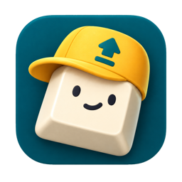

<p align="center">
  
</p>

# Caplet

A tiny macOS menu-bar window manager. It moves the focused window of whatever app is in front.

Hold **Caps Lock** (⇪) and press a key with the same hand:

| Action | Shortcut |
|---|---|
| Top half | ⇪W |
| Left half | ⇪A |
| Bottom half | ⇪S |
| Right half | ⇪D |
| Top-left quarter | ⇪Q |
| Top-right quarter | ⇪E |
| Bottom-left quarter | ⇪Z |
| Bottom-right quarter | ⇪X |
| Maximize (fill the visible screen) | ⇪F |
| Center, keeping the window's size (shrunk only if it doesn't fit) | ⇪C |
| Move to next display, keeping its relative size and position | ⇪Space |

```
Q  W  E        ↖  ↑  ↗
 A  S  D        ←  ↓  →
  Z  X  C       ↙  ↘  center
```

The same actions, with their shortcuts, are also in the menu-bar icon's menu.

The first press keeps the window's size when it can, and repeated presses cycle sizes:

- **Halves:** if the window fits in that half, the first press only slides it against the
  edge (⇪A keeps its height position, ⇪W its horizontal position). Then ½ → ⅔ → ⅓ → ½ of
  the screen (width for left/right, height for top/bottom).
- **Quarters:** if the window fits in that quarter, the first press only slides it into the
  corner. Then the width cycles ½ → ⅔ → ⅓ the same way; the height stays half the screen.
- **Center:** the first press centers the window at its own size. The second resizes it to ⅔
  of the screen's width and height. Further presses keep it at ⅔.

The slide is skipped, and the first press goes straight to ½, when the window is bigger than
the half or quarter, already against that edge, or within a few points of ½ anyway. Once a
window has been resized, the cycle never slides it again.

A repeated press advances when the window is still where the last press put it, or already
sits at one of those sizes. Otherwise it starts again at the first step. Turn this off with
**Cycle Sizes on Repeated Presses** in the menu. Then halves and quarters always go to ½
(no slide), and Center always keeps the window's size.

### Arrange

Add **Option** (⌥) to tile the focused window together with the windows right behind it,
like Window › Move & Resize › Arrange in macOS Sequoia:

| Arrange | Shortcut | Focused window goes |
|---|---|---|
| Left & Right | ⌥⇪A | left; the next window goes right |
| Right & Left | ⌥⇪D | right; the next window goes left |
| Top & Bottom | ⌥⇪W | top; the next window goes bottom |
| Bottom & Top | ⌥⇪S | bottom; the next window goes top |
| Quarters | ⌥⇪Q / ⌥⇪E / ⌥⇪Z / ⌥⇪X | into that corner; the next three windows fill the other corners in reading order |

- "Behind" means the stacking order, so the windows you used most recently join first.
  They can come from any app.
- Only windows on the focused window's display take part. Minimized windows, hidden apps,
  other Spaces, dialogs, panels, and very small windows are skipped.
- With fewer windows than slots, the windows that exist are tiled and the rest of the
  screen stays empty.
- Nothing is brought to the front, so focus stays where it was. Arrange doesn't cycle sizes.
- ⌥ with F, C, or Space does the same thing as without it.

The menu lists the Arrange layouts too. Its **Quarters** item puts the focused window top-left.

### About Caps Lock

Caps Lock still works as Caps Lock:

- **Tap it alone** to toggle capitals, as usual.
- **Hold it and press a key** for a ⇪ shortcut. Capitals don't toggle.

A press counts as a tap when no other key went down while Caps Lock was held, and it was
released within half a second. Holding Caps Lock and letting go without pressing anything
does nothing. Other keys pressed while holding Caps Lock type normally. The bound keys are
matched by physical position, so they stay under your left hand on any keyboard layout.

Behind the scenes, Caplet remaps the Caps Lock key to F18, and it toggles capitals itself
when you tap. Quitting Caplet removes the remap and restores any Caps Lock remap you had
before. If Caplet crashes, Caps Lock stays remapped (no capitals, no shortcuts) until you
relaunch it, log out, or run:

```bash
hidutil property --set '{"UserKeyMapping":[]}'   # also clears any other hidutil remaps
```

Caplet checks the remap again after the Mac wakes, when a keyboard is connected, and when
you open its menu, and puts it back on any keyboard that lost it. Only one app can remap
Caps Lock at a time, though. If another one has done so since (Raycast's Hyper Key does
this on every wake, for example), Caplet leaves it alone. The menu then says the ⇪ shortcuts
are off, the menu-bar icon dims, and **Take Back Caps Lock** remaps it to F18 again. To stop
the two apps fighting over the key, turn off the other app's Caps Lock feature.

## Install

Requires macOS 13 or later, on Apple silicon or Intel.

1. Download `Caplet-<version>.zip` from the
   [latest release](https://github.com/zhe/caplet/releases/latest), unzip it (Safari may
   already have), and drag `Caplet.app` into `/Applications`.
2. Open it. The app isn't notarized (that needs the paid Developer Program), so macOS
   refuses the first time. Go to System Settings › Privacy & Security, scroll down, and
   click **Open Anyway** next to the Caplet message. Alternatively, clear the download flag
   from Terminal before opening it:

   ```bash
   xattr -dr com.apple.quarantine /Applications/Caplet.app
   ```

3. When asked, enable Caplet under System Settings › Privacy & Security › Accessibility.
   Tick **Launch at Login** in its menu if you want it.

To update, quit Caplet from its menu first, so Caps Lock goes back to normal, then replace
the app with the newer one the same way. Releases are all signed with the same certificate,
so Caplet keeps its Accessibility permission across updates.

## Build from source

Building needs Xcode 15+ (or the matching Command Line Tools).

If `swift build` fails with `Invalid manifest` and `Undefined symbols ... PackageDescription`,
the Command Line Tools are out of sync with macOS (common after an OS upgrade). Reinstall them:

```bash
sudo rm -rf /Library/Developer/CommandLineTools && xcode-select --install
```

### Run it

```bash
./scripts/bundle.sh
open build/Caplet.app
```

On first launch macOS asks for **Accessibility** access. Enable Caplet in
System Settings › Privacy & Security › Accessibility. Until you do, the menu shows a
"Grant Accessibility Access…" item. The ⇪ shortcuts start by themselves a couple of seconds
after you grant it.

### Signing

Without a signing certificate, the bundle is ad-hoc signed, and macOS treats every rebuild
as a new app. Shortcuts then stop working after each rebuild until you remove Caplet from
the Accessibility list (the `–` button) and add it again.

A signing certificate avoids that. Neither option needs the paid Apple Developer Program:

- **Apple Development certificate (free Apple account):** in Xcode › Settings › Accounts,
  sign in, select your team, click **Manage Certificates…**, then **+** › **Apple
  Development**. `bundle.sh` finds it automatically. If the script still says "ad-hoc
  signed", macOS is missing Apple's intermediate certificate; the script prints the
  one-line command that installs it.
- **Self-made certificate (no Apple account):** in Keychain Access › Certificate Assistant ›
  **Create a Certificate…**, give it a name (e.g. `Caplet Local`), set **Certificate
  Type** to **Code Signing**, and create it. Then tell the script to use it:

  ```bash
  SIGN_IDENTITY="Caplet Local" ./scripts/bundle.sh --install
  ```

  If `codesign` rejects it, open the certificate in Keychain Access, expand **Trust**, and
  set **Code Signing** to **Always Trust**.

The script prints which signature it used. After the first build with a certificate,
re-add Caplet under Accessibility once; later rebuilds keep the permission. To run the app
on other Macs, see [Install](#install) and [Other Macs](#other-macs).

`swift run Caplet` also works for quick iteration, but then macOS asks to grant
Accessibility access to your terminal app instead.

### Launch at login

Install the app into `/Applications`, open it from there, and tick **Launch at Login** in the
menu (off by default):

```bash
./scripts/bundle.sh --install
open /Applications/Caplet.app
```

The setting lives in macOS, and also appears under System Settings › General › Login Items.
If you switch it off there, the menu shows the checkbox as mixed (–); clicking it opens that
settings page. Use `--install` for later rebuilds too, so the login item keeps pointing at
the current build. It quits the running copy first, which restores Caps Lock.

### Other Macs

To try a local build on another Mac without publishing a release, pack it:

```bash
./scripts/bundle.sh --zip      # writes build/Caplet.zip
```

Send `Caplet.zip` over AirDrop, a shared folder, or a drive, then follow [Install](#install)
from step 1. Ad-hoc builds need to be re-added under Accessibility after each update. This
build only runs on the kind of chip it was built on (Apple silicon or Intel); `--release`
builds run on both.

### Releasing

Releases are built on a Mac that has the signing certificate (see [Signing](#signing)), so
every release carries the same signature and users keep their Accessibility permission when
they update. Push `main`, then run the script with the next
[semantic version](https://semver.org):

```bash
./scripts/release.sh 0.1.0
```

It checks that the working tree is clean and matches `origin/main`, runs the tests, builds a
universal app (`bundle.sh --release`), and uploads `Caplet-0.1.0.zip` as a **draft** release.
The draft's notes list the commits since the previous release, followed by the pull requests
merged since then. Edit them on GitHub, then click **Publish release**. Publishing creates
the `v0.1.0` tag; until then you can delete the draft and run the script again.

## Tests

```bash
swift test
```

The tests cover `CapletCore`: coordinate flipping, halves, size cycling, picking a screen,
moving between displays, picking and placing windows for Arrange, ⇪ key bindings, and the
`hidutil` remap handling. That module is
plain Foundation, so the tests also run on Linux.

## How it works

| File | Role |
|---|---|
| `Sources/CapletCore/Layout.swift` | Pure geometry, all in Accessibility coordinates (top-left origin of the primary display, y down). |
| `Sources/CapletCore/Cycle.swift` | Picks the step for each press: slide or center at the window's own size first, then the next size on repeated presses (halves, quarters, and center). It compares against the frame the app actually accepted, because apps like Terminal round sizes. |
| `Sources/Caplet/WindowMover.swift` | Accessibility API (`AXUIElement`): finds the frontmost app's focused window, reads its frame, writes the new one. |
| `Sources/CapletCore/Arrange.swift` | Arrange layouts: which slot each window gets, and which windows behind the focused one may join. |
| `Sources/Caplet/WindowList.swift` | Lists on-screen windows front to back (`CGWindowListCopyWindowInfo`) and matches them to Accessibility windows by window ID. |
| `Sources/CapletCore/HyperKey.swift` | Hyper-key bindings, plus reading, merging, and writing `hidutil` key remaps. |
| `Sources/Caplet/HyperKeyController.swift` | Remaps Caps Lock to F18 with `hidutil`. A keyboard event tap tracks F18 being held and swallows the bound keys. Caps Lock alone can't do this, because it only reports on/off toggles. |
| `Sources/CapletCore/CapsTap.swift` | Tells a tap of Caps Lock (toggle capitals) apart from holding it for a shortcut. |
| `Sources/Caplet/CapsLockState.swift` | Flips the system Caps Lock state through IOHIDSystem, the same state the physical key toggles. |
| `Sources/Caplet/LoginItem.swift` | Launch at login through `SMAppService.mainApp`. |
| `Sources/Caplet/AppDelegate.swift` | Menu-bar item, menu, and shortcut wiring. |
| `Resources/` | The app icon (`AppIcon.icns`) and the menu-bar icon (`MenuBarIcon.png`, a 36×36 black-on-transparent template image shown at 18 points). `bundle.sh` copies both into the app. |

Details handled:

- `NSScreen` frames use a bottom-left origin; Accessibility uses top-left. `Layout.flip` converts between them.
- The size is set before and after the position, so windows aren't clamped to the old screen when they cross displays.
- `AXEnhancedUserInterface` is turned off for the duration of a move. When it's on, apps animate frame changes slowly.
- Accessibility calls time out after 1 second, so a hung app can't freeze Caplet.
- Full-screen windows are skipped, and the app beeps.
- Arrange matches windows with the private `_AXUIElementGetWindow`. Most window managers use
  it, and it has been stable for years. Window titles, which would need Screen Recording
  access, are never read.

## Not included

Spaces, Stage Manager, and automatic tiling (windows rearranging themselves as they open or
close). Spaces have no public API.
